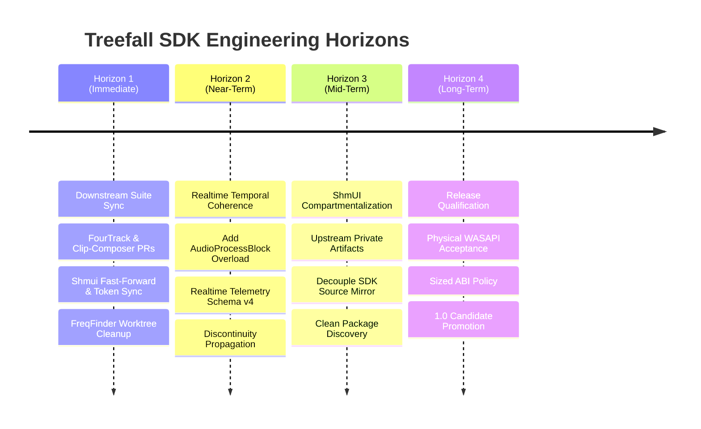

<!-- SPDX-License-Identifier: MIT -->

# ORP277 — Treefall SDK Coherence Audit, Downstream Suite Sync, and Strategic Roadmap

**Date:** 2026-10-29  
**Author:** Treefall SDK Agent  
**Status:** Complete / Approved Roadmap  
**Scope:** `orpheus-sdk` HEAD (`901fc1d33`), Orpheus Suite (`shmui`, `fourtrack`, `freqfinder`, `clip-composer`), ORP document corpus  

---

## 1. Executive Summary & Core Advisory

This audit evaluates the current technical state of the Treefall SDK codebase following the merge of PR #277 (`feat/orp273-sprint-remediation`), reviews outstanding and deferred objectives across the ORP document history, inspects downstream suite synchronization, and assesses overall architectural coherence.

### Direct Answers to Core Inquiries

1. **Are there major objectives deferred or outstanding in the ORP corpus?**  
   **Yes.** While internal rendering and engine mechanics are stable, several critical objectives remain explicitly open and deferred:
   - **ORP268 Requirement A (Critical):** Transport clock-domain, hardware timestamp, and stream discontinuity propagation across the audio driver callback boundary (`AudioProcessBlock`) into `ITransportController::processAudio` and `RealtimeTelemetrySnapshot`.
   - **ORP268 Requirement B (High):** Sized C ABI table handshake and negotiation in `include/orpheus/abi.h`.
   - **ORP276:** ShmUI private source compartmentalization and packaging handoff (decoupling private UI source bytes from public SDK discovery).
   - **AGENTS.md & ORP143 §7:** Windows/WASAPI physical hardware qualification via `tools/wasapi_hardware_acceptance.cpp` remains gated on real-device acceptance records.
   - **ORP262:** Unresolved active branches and pull requests (PR #250 for directional sample-rate conversion, PR #247 for directional buffer monitoring, and PR #260 for URL standardization).

2. **Should we run a refactoring and optimization pass?**  
   **No.** An extensive, 20-finding refactoring and performance remediation sprint (ORP273) was executed across 5 waves (ORP274), validated through consumer-safety review (ORP275), and merged into `main` at commit `901fc1d33` via PR #277 on 2026-10-23. The render-path p99 deadline ratio is currently 0.485 (10,352.7 µs vs 21,333.3 µs ceiling), math is strictly deterministic across target architectures (`0x212b8a01988459a9`), and the audio thread is verified 100% allocation-free. Initiating another immediate SDK-internal optimization pass before downstream consumers adopt and soak PR #277 would represent premature optimization and unproductive churn.

3. **Check sync against downstream consumer apps:**  
   **Substantially drifted.** A non-destructive inventory using `python3 tools/suite.py status` reveals that all four downstream suite repositories (`shmui`, `fourtrack`, `freqfinder`, and `clip-composer`) are in a drifted or uncommitted state relative to `main` and PR #277. While local worktrees for `fourtrack` and `clip-composer` have updated submodule pointers to `901fc1d33` on experimental feature branches, these have not been harmonized, tested against release packages, or merged upstream.

4. **Check overall coherence of the Treefall SDK codebase:**  
   **Strong internal coherence with one major architectural seam.**  
   - *Branding vs ABI:* The product rebrand to Treefall SDK (ORP265) is cleanly maintained alongside the strict preservation of the `orpheus` C++ namespace, `include/orpheus/` headers, `Orpheus::*` CMake targets, and C ABI 1.0.
   - *Realtime Safety:* Strict static audit passes with 0 hard failures and 0 debt items; CoreAudio route changes and buffer limits (4096-frame ceiling) are atomic and safe.
   - *Temporal Coherence:* Phase and sample alignment within the transport render loop are verified; however, the lack of clock-domain and hardware timestamp propagation across the `AudioProcessBlock` boundary represents an unfulfilled requirement of `ARCHITECTURE.md` §Temporal Coherence.

---

## 2. Status of Outstanding and Deferred Objectives

### 2.1 ORP268 Requirement A: Clock Domain and Discontinuity Plumbing (Critical)
- **Problem Statement:** In `include/orpheus/audio_driver.h:311-320`, the `AudioProcessBlock` structure carries rich hardware timing metadata:
  ```cpp
  struct AudioProcessBlock {
    const float* const* input_buffers = nullptr;
    float* const* output_buffers = nullptr;
    uint16_t num_input_channels = 0;
    uint16_t num_output_channels = 0;
    uint32_t num_frames = 0;
    uint64_t device_sample_position = 0;
    uint64_t host_time_nanoseconds = 0;
    bool discontinuity = false;
  };
  ```
  However, the entry point for transport rendering in `include/orpheus/transport_controller.h:1028-1029` discards this timing context:
  ```cpp
  virtual void processAudio(float* const* outputBuffers, size_t numChannels,
                            size_t numFrames) noexcept = 0;
  ```
  Furthermore, `RealtimeTelemetrySnapshot` in `include/orpheus/realtime_telemetry.h:80-95` publishes only the canonical post-block transport `TimePoint position` and monotonic `sequence`, with no hardware clock reference, host timestamp, or discontinuity marker.
- **Architectural Risk:** When audio output devices experience sample-rate drift, clock domain shifts, or buffer underruns, downstream consumers (such as ShmUI meters or multi-track visualizers) cannot detect phase skew or account for hardware latency variations.
- **Remediation Requirement:** 
  1. Add an additive virtual method overload to `ITransportController`:
     ```cpp
     virtual void processAudio(const AudioProcessBlock& block, float* const* outputBuffers) noexcept;
     ```
  2. Bump `kRealtimeTelemetrySchemaVersion` from 3 to 4 in `include/orpheus/realtime_telemetry.h:19`, adding `uint64_t device_sample_position`, `uint64_t host_time_nanoseconds`, and `bool discontinuity`.

### 2.2 ORP268 Requirement B: Sized C ABI Handshake (High)
- **Problem Statement:** In `include/orpheus/abi.h:103-138`, the stable C ABI tables (`orpheus_session_api_v1`, `orpheus_clipgrid_api_v1`, `orpheus_render_api_v1`) begin directly with `uint64_t caps;` followed by function pointers:
  ```cpp
  typedef struct orpheus_session_api_v1 {
    uint64_t caps;
    orpheus_status (*create)(orpheus_session_handle* out_session);
    // ...
  } orpheus_session_api_v1;
  ```
  There is no `uint32_t struct_size;` field or tail padding. If new functions are appended within ABI 1.0, precompiled callers passing smaller structures or indexing past allocated boundaries will incur memory corruption.
- **Current Status:** Gated on a policy choice: either accept append-only extension as an explicitly documented limitation of ABI 1.0 (with rebuild required for callers utilizing new methods), or introduce a sized negotiation handshake at ABI 2.0.

### 2.3 ORP276: ShmUI Private Source Compartmentalization Handoff
- **Problem Statement:** The SDK currently mirrors ShmUI private sources under `packages/shmui-juce/`. While `CMakeLists.txt` defaults `ORPHEUS_ENABLE_SHMUI_JUCE` to `OFF`, the private source files remain present in the SDK repository checkout.
- **Handoff Contract:** As recorded in ORP276, the SDK team cannot unilaterally delete or decouple these sources without breaking downstream consumers (`fourtrack`, `freqfinder`). The ShmUI team owns the responsibility to publish private artifact distribution (tarballs/prebuilt packages); only then will the SDK migrate build scripts and consumers.

### 2.4 AGENTS.md & ORP143 §7: Windows/WASAPI Physical Hardware Gating
- **Problem Statement:** While the WASAPI backend compiles and passes format reconciliation unit tests in CI (`wasapi_format_reconciliation_test`), it cannot be promoted to supported status in `docs/SUPPORT_MATRIX.md` without execution on physical Windows audio hardware.
- **Current Status:** The hardware acceptance fixture exists in `tools/wasapi_hardware_acceptance.cpp`, but execution records from real hardware remain pending.

### 2.5 ORP262: Branch Resolution and Open PR Inventory
- **Unresolved Pull Requests:**
  - PR #250 (`release/orp176-coreaudio-directional-src`): Directional sample-rate conversion.
  - PR #247 (`fix/coreaudio-directional-buffer-monitor`): Directional buffer monitoring telemetry.
  - PR #260 (`chore/boot-industries-urls`): Documentation URL cleanup.
- **Branches:** Local and remote branches need pruning once PRs #247 and #250 are formally merged or retired.

---

## 3. Evaluation of Optimization Pass Need (ORP273–275 Review)

A central inquiry of this audit is whether an additional refactoring and performance optimization pass should be undertaken immediately. Based on the delivery of PR #277, the recommendation is **unambiguously negative**.

### 3.1 PR #277 Optimization Delivery Summary
The ORP273 remediation sprint addressed 20 comprehensive findings across 5 waves:
- **Wave 0 (Hygiene):** Added test allocator hooks to guarantee 0 audio-thread allocations during stress tests; isolated Release benchmark configurations.
- **Wave 1 (Realtime Correctness):** Eliminated waiter notifications from the CoreAudio realtime device callback (F-01); established a hard 4096 callback-frame ceiling enforced prior to buffer allocation (F-11).
- **Wave 2 (Render Path & Math Determinism):** Eliminated host `libm` dependencies (F-02) by implementing platform-independent elementary math approximations (piecewise rational/polynomial soft clipping, bitwise constants); pinned the cross-platform render-hash golden to `0x212b8a01988459a9`; eliminated whole-pool lane `memset` churn (F-07); eliminated the redundant TruePeak rescan pass (F-10); pinned compressor `pow` calculations to precomputed gain lookups (F-06); eliminated per-block 17,936-byte telemetry allocation (F-05).
- **Wave 3 (Decomposition):** Bounded JSON and session document parser memory (F-12); implemented allocation-free transaction rollback (F-14); extracted the control-side clip-source registry (F-15); extracted matrix-level meter state (F-16).
- **Wave 4 (Tooling & Calibration):** Calibrated the TruePeak release deadline gate with vectorized x86 reduction and strict MSVC `/fp:precise` flags.

### 3.2 Observed Performance and Budget Metrics
Evidence recorded in ORP274 and ORP275 confirms that current performance is well within all contractual budgets:

| Metric | Measured Value | Budget Ceiling | Margin / Headroom |
| :--- | :--- | :--- | :--- |
| **TruePeak Wall p99** | 10,352.7 µs | 21,333.3 µs | +51.5% headroom (Ratio: 0.485 vs 0.500) |
| **Render Hash Golden** | `0x212b8a01988459a9` | Fixed Constant | Exact match across ARM64 & x86_64 |
| **Audio-Thread Allocations** | 0 allocations / 0 frees | 0 | 100% allocation-free |
| **CoreAudio Route Ceiling** | 4096 frames | 4096 frames | Validated refusal on overflow |

### 3.3 Strategic Conclusion
Core DSP performance and memory boundaries are currently optimal and heavily guarded. Any further optimization at this stage would lack real-world profiling data from downstream applications. Priority must shift from engine micro-optimization to downstream consumer integration.

---

## 4. Downstream Suite Synchronization Audit

A complete audit of downstream suite checkouts was conducted using `python3 tools/suite.py status` across the workspace `/Users/chrislyons/dev`.

### 4.1 Suite Repository Status Matrix

| Repository | Current Branch | Worktree State | SDK Pin (Actual) | SDK Pin (Expected) | Pin Status |
| :--- | :--- | :--- | :--- | :--- | :--- |
| **orpheus-sdk** | `main` | Clean | `901fc1d33` (HEAD) | `901fc1d33` | Floating (Authoritative) |
| **shmui** | `main` | Clean | N/A (Upstream) | N/A | Drifted from `origin/main` |
| **fourtrack** | `chore/ftr-sdk-901fc1d` | Clean | `901fc1d33` | `56a81fcdff` | Drifted against manifest |
| **freqfinder** | `main` | **Dirty** | `901fc1d33` | `901fc1d33` | CMake source override pinned |
| **clip-composer** | `fix/occ-menu-transport-stability` | Clean | `901fc1d33` | `e885ddcf7d` | Drifted against manifest |

### 4.2 Detailed Downstream Findings

1. **`fourtrack`:**
   - Active branch is `chore/ftr-sdk-901fc1d`.
   - The git submodule `third_party/orpheus-sdk` has been manually advanced to `901fc1d3305ed0dead21f39f261fb755ba92c538`, matching SDK HEAD.
   - However, the suite manifest expects declared pin `56a81fcdff445b43d1ba4d9b6684efbbffd11e32`.
   - Artifact `fourtrack-shmui-manifest` reports `source-changed` provenance drift.
   - *Requirement:* Create and merge a formal FourTrack PR incorporating PR #277 changes, then update the suite manifest.

2. **`clip-composer`:**
   - Active branch is `fix/occ-menu-transport-stability`.
   - Submodule `third_party/orpheus-sdk` is at `901fc1d3305ed0dead21f39f261fb755ba92c538`.
   - Expected declared pin in manifest is `e885ddcf7d3113f5794b31103cd40e90f0d03745`.
   - *Requirement:* Coordinate branch completion and suite manifest pin update.

3. **`freqfinder`:**
   - Worktree is currently dirty with local unstaged modifications.
   - It references `orpheus-sdk` via CMake source override, which successfully resolves to `901fc1d33`.
   - However, its `shmui` dependency pin is drifted: actual revision is `e8c8f1ea` while expected remote tracking revision is `452fb204`.
   - *Requirement:* Clean worktree modifications and align `shmui` revision.

4. **`shmui`:**
   - Local checkout is at commit `e8c8f1ea347ee4b1040e5468785ff86a00858355`.
   - Remote tracking branch `origin/main` is ahead at `452fb2042ac63254e68fbc7f8d41d299e3c9d72d`.
   - *Requirement:* Fast-forward local `shmui` checkout to `origin/main` and sync tokens into downstream packages.

---

## 5. Treefall SDK Codebase Coherence Assessment

### 5.1 Product Identity and Compatibility Invariants
- **Naming Policy:** Per ORP265, "Treefall SDK" is the active public product identity, while `orpheus` is preserved as the technical compatibility namespace.
- **Verification:**
  - Headers in `include/orpheus/` remain authoritative. Forwarding headers under `include/treefall/` redirect cleanly.
  - CMake targets provide both `Orpheus::*` and `Treefall::*` aliases.
  - C ABI exports retain `orpheus_*` prefixes indefinitely during ABI 1.0.
  - `python3 tools/version_contract.py --check` confirms strict version consistency at `0.9.1`.

### 5.2 Realtime Safety and Determinism
- **Audit Tool Output:** `python3 tools/realtime_audit.py` executed across all source files under `src/` and headers under `include/orpheus/`:
  - **Hard failures:** `0`
  - **Tracked debt findings:** `0`
- **Execution Invariants:**
  - No heap allocations on audio rendering paths (`AudioProcessBlock`, `processAudio`, `render_tracks`).
  - No blocking locks or synchronization primitives on realtime threads.
  - Atomic SPSC queues and lock-free rings govern all audio-to-control message passing.

### 5.3 Temporal Coherence
- **Architecture Mandate:** Per `ARCHITECTURE.md` §Temporal Coherence, all time must be canonical integer samples; seconds, beats, and timecode are derived views.
- **Status:** Within the transport engine, sample accuracy and phase alignment are preserved. However, as noted in Section 2.1, the lack of hardware timestamp ingestion through `ITransportController::processAudio` prevents the engine from compensating for external DAC clock drift or detecting physical bus discontinuities.

### 5.4 Build, Package, and Distribution Integrity
- **Installed Package Verification:** Clean-prefix package testing via `ctest -R cmake_find_package` confirms that external consumers can consume installed `TreefallSDK` and `OrpheusSDK` CMake targets without access to private repository paths.
- **Documentation Path Audit:** `python3 tools/docs_path_audit.py` validates that all public documentation cross-links and referenced paths resolve with 0 broken links.

---

## 6. Strategic Next Steps & Prioritized Roadmap

To translate this audit into actionable execution, work is organized into four prioritized horizons:



### Horizon 1: Downstream Suite Synchronization & Pin Harmonization (Immediate)
- **Goal:** Eliminate downstream drift and bring all child applications onto SDK HEAD (`901fc1d33`).
- **Steps:**
  1. Fast-forward `/Users/chrislyons/dev/shmui` to `origin/main` (`452fb204`).
  2. Sync ShmUI manifest and tokens using `python3 tools/shmui_juce_manifest.py --sync`.
  3. Finalize and merge `chore/ftr-sdk-901fc1d` in `fourtrack` and `fix/occ-menu-transport-stability` in `clip-composer`.
  4. Clean modified files in `freqfinder`.
  5. Run `python3 tools/suite.py update orpheus-sdk --revision 901fc1d3305ed0dead21f39f261fb755ba92c538 --affected --apply --yes` to record the synchronized state in `suite/orpheus-suite.json`.

### Horizon 2: Realtime Temporal Coherence & Clock Plumbing (Near-Term)
- **Goal:** Implement ORP268 Requirement A to fulfill `ARCHITECTURE.md` §Temporal Coherence.
- **Steps:**
  1. Define additive virtual method overload in `include/orpheus/transport_controller.h`:
     ```cpp
     virtual void processAudio(const AudioProcessBlock& block, float* const* outputBuffers) noexcept;
     ```
  2. Forward `device_sample_position`, `host_time_nanoseconds`, and `discontinuity` from `AudioProcessBlock` into `TransportController`.
  3. Update `include/orpheus/realtime_telemetry.h`: bump `kRealtimeTelemetrySchemaVersion` from 3 to 4, appending the hardware timing fields to `RealtimeTelemetrySnapshot`.
  4. Add unit and integration tests verifying discontinuity detection and timestamp propagation.

### Horizon 3: ShmUI Private Compartmentalization Cutover (Mid-Term)
- **Goal:** Execute ORP276 handoff once ShmUI private packaging is established.
- **Steps:**
  1. Coordinate with ShmUI team on private distribution artifact endpoints.
  2. Decouple `packages/shmui-juce/` mirror from public SDK source tree while preserving CMake discovery via `Orpheus::shmui_juce`.
  3. Validate downstream UI acceptance across FourTrack and Clip-Composer.

### Horizon 4: Hardware Acceptance & Stable 1.0 Promotion (Long-Term)
- **Goal:** Complete platform support matrix requirements and promote candidate release.
- **Steps:**
  1. Execute `tools/wasapi_hardware_acceptance.cpp` on physical Windows audio hardware; record latency and buffer metrics in `docs/SUPPORT_MATRIX.md`.
  2. Formalize C ABI policy for `include/orpheus/abi.h` (record append-only contract for ABI 1.0; reserve sized handshake for ABI 2.0).
  3. Resolve or merge open PRs #247, #250, and #260.
  4. Promote candidate snapshot to stable release per ORP170/ORP173 criteria.
